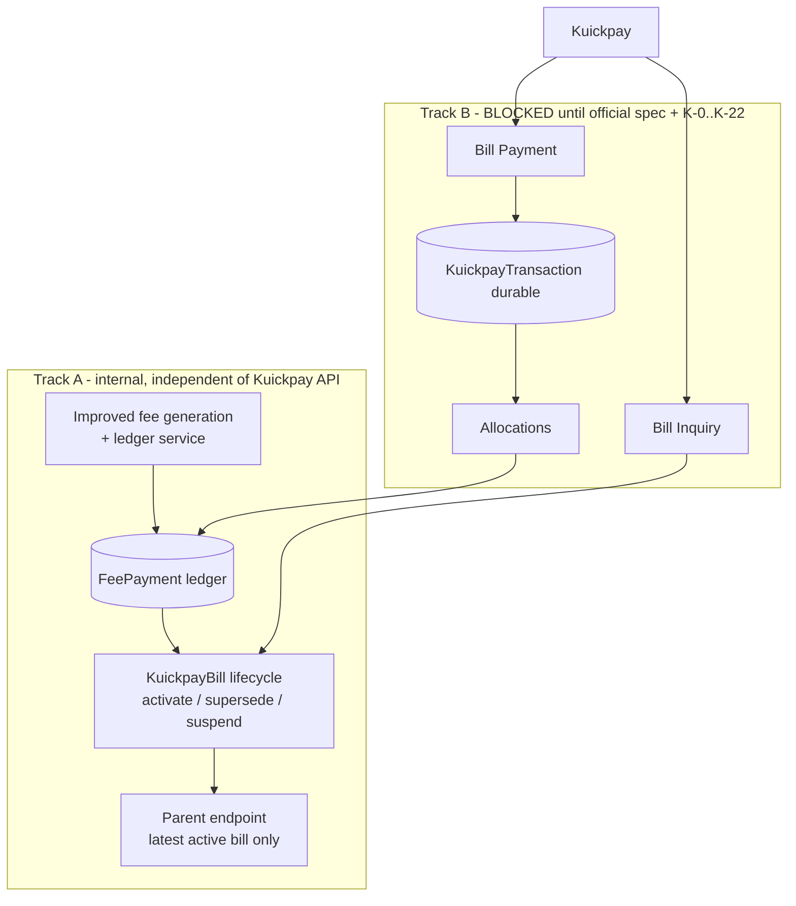
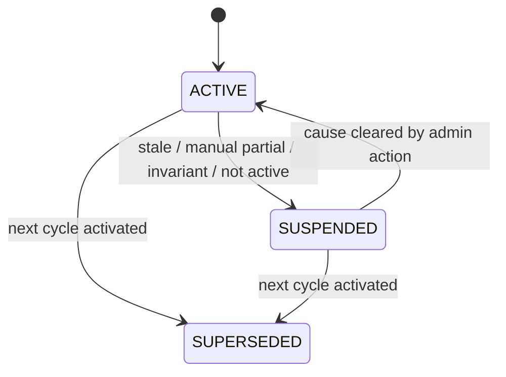
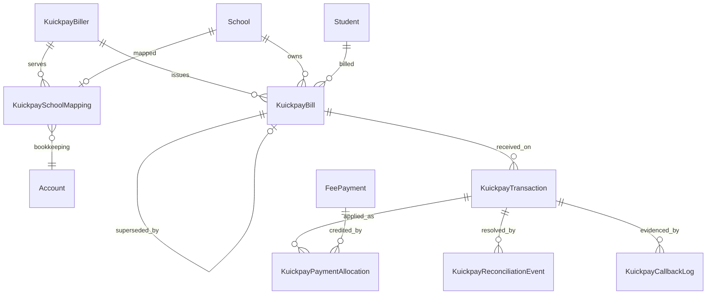
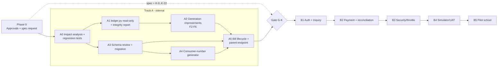

# Kuickpay End-to-End Integration — Final Implementation Baseline (Revision 3)

> **Status:** PLANNING ONLY — submitted for approval. No application code, model, migration, database, environment or deployment file was changed to produce this document.
> **Repository:** `shahmir3899/kodereduai` (Education AI), commit `68a306b`. `~` = approximate line.
> **Supersedes** Revisions 1–2.

## Build status

| Phase | Status |
|---|---|
| A0 regression/characterization tests + impact analysis | **Done** — `finance/test_fee_generation_regression.py`, `docs/KUICKPAY_A0_IMPACT_ANALYSIS.md` |
| A3 models + migration `0028` | **Done** — verified on SQLite and PostgreSQL 16, reversible |
| A1 `finance/ledger.py` + `kuickpay_ledger_report` command | **Done** |
| A2 generation improvements F-1, F-2, F-3, F-4, F-8 | **Done** — see "A2 as built" below |
| A4 consumer-number generator, A5 bill lifecycle + parent endpoint | Not started |
| Track B (live endpoints) | **Blocked** — official Kuickpay specification and K-0…K-22 |

**A2 as built (deviations from the plan text).** (1) `delete_recreate` keeps the batched queryset delete but only for rows without a recorded payment or allocation, instead of switching to per-row `delete()`; the target period is verified open before the run starts. (2) The explicit administrator refresh is `ledger.refresh_chain` and the `kuickpay_ledger_report --refresh [--apply]` command; no new API endpoint was added. (3) `generate_single` is now one transaction with row locks. (4) `ProtectedError` is mapped to HTTP 409 in `core.views.custom_exception_handler`.

---

## 0. How to read this document

| Tag | Meaning |
|---|---|
| **[AD]** | **Approved decision** — you approved it (register in §2) |
| **[V]** | **Verified existing behaviour** — confirmed in this repository's code |
| **[P]** | **Proposed design** — my recommendation implementing approved decisions; detail still subject to review |
| **[NA]** | **New proposal needing approval** — not covered by an approved decision (collected in §20) |
| **[K]** | **External dependency** — needs Kuickpay's official answer (§19) |

**Two kinds of work are kept strictly apart (§16):**
* **Track A — internal.** Fee-ledger improvement, bill model, bill lifecycle, parent endpoint. Does not depend on Kuickpay's API.
* **Track B — Kuickpay-facing.** Live Bill Inquiry / Bill Payment, authentication, response codes, simulator/UAT. **Blocked until the official specification is obtained and K-0…K-22 are answered.** Nothing in Track B may be coded against assumed API behaviour.

**Official Kuickpay specification status [K]:** no Kuickpay document exists in the repository (content search for `kuickpay`/`biller`/`consumer number` found nothing before these plans). `developers.kuickpay.com` still does not resolve from this environment. **No API field, header name, response code, amount unit, consumer-number format, transaction-identity guarantee or expiry behaviour is verified** (§19). This document defines *internal* behaviour and the *conditions the spec must satisfy*; it never states what Kuickpay's wire format is.

---

## 1. Executive summary and final architecture

1. **Single ledger [AD][V].** `finance.FeePayment` (`models.py:464`) remains the only fee-liability ledger. Kuickpay **consumes** it through one read-only service (`finance/ledger.py`); there is no parallel calculation, balance or accounting ledger.
2. **Fee-generation is improved first [AD].** The existing generator has verified defects that would make Kuickpay collect wrong amounts (§4): balance dropped when an intervening month row is missing, stale `previous_balance` snapshots, unlocked concurrent payment/generation, `delete_recreate` destroying recorded payments, discounts not applied. Track A fixes the ledger so that Kuickpay can trust it.
3. **One cumulative bill per student per monthly cycle [AD].** `KuickpayBill` is a payable *reference* (permanent consumer number) over the ledger; it is not a second liability. Annual/one-time fees are outside release 1 [AD].
4. **Supersession [AD].** Activating a new cycle bill immediately sets the previous bill `SUPERSEDED` (same DB transaction, row-locked); a DB constraint guarantees at most one open bill per student. Expiry never cancels the liability, which stays in the ledger and carries forward.
5. **Payment durability [AD][P].** Every authenticated payment callback is stored first (`KuickpayTransaction`), posted second (`KuickpayPaymentAllocation` → `FeePayment.save()`), idempotently, with retry + reconciliation. Closed periods are never bypassed.
6. **Expired-payment policy [AD]:** no grace; timestamp ≤ `superseded_at` ⇒ in-flight, applied once to the successor; later ⇒ retained as exceptional, urgent reconciliation, never auto-credited (§8).
7. **Manual vs online [AD].** Kuickpay is suspended where a manual payment makes safe allocation impossible; manual edits cannot reduce a row's payment below its confirmed Kuickpay allocations.
8. **Rollout [AD].** One pilot school; per-school enablement; one internal bookkeeping Bank `Account` per school; no assumption of separate Kuickpay settlement per school.



---

## 2. Approved business-decision register

| ID | Approved decision | Source (your message) |
|---|---|---|
| **AD-1** | One cumulative Kuickpay bill per student per monthly cycle, covering all applicable monthly fee categories | §1.1 |
| **AD-2** | Annual and one-time fees excluded from release 1 | §1.2 |
| **AD-3** | Activating a new monthly bill immediately sets the previous bill `SUPERSEDED` and non-payable | §1.3 |
| **AD-4** | Only the latest active bill may be paid | §1.4 |
| **AD-5** | Expiring a consumer number never cancels the underlying liability | §1.5 |
| **AD-6** | All bills, callbacks, transactions and allocations retained (no deletion) | §1.6 |
| **AD-7** | Rollout starts with one pilot school | §1.7 |
| **AD-8** | Parent app shows only the latest payable bill as active; expired bills only in history, always non-payable | §1.8, §9 |
| **AD-9** | Improve the existing fee-generation system itself (missing-row carry-forward, stale snapshots, concurrency, multiple categories, closed periods, partial payments, modes skip/update/delete_recreate, discounts/scholarships/transfers) preserving existing functionality and conventions; Kuickpay consumes the corrected ledger; regression tests prepared first | §2 |
| **AD-10** | Expired-payment policy: no grace; timestamp ≤ supersession ⇒ in-flight, applied once to successor; timestamp > supersession ⇒ not auto-credited, retained, urgent reconciliation/refund; expired inquiry returns Kuickpay's expired response; never discard, never double credit; consistent timezone documented; **stop if the spec cannot support this** | §3 |
| **AD-11** | Partial payments only if Kuickpay supports; allocation never exceeds outstanding; overpayment rejected before debit where possible, else excess retained `HELD`; order: oldest outstanding period, then ascending category ID; allocations stored independently; posting idempotent | §4 |
| **AD-12** | Suspend Kuickpay where manual payments make safe allocation impossible; confirmed Kuickpay allocations protected from manual overwrite; manual updates cannot reduce recorded payment below confirmed allocations; compatible with existing Finance module | §5 |
| **AD-13** | Ledger posting uses Education AI posting date; original Kuickpay date/time stored separately; closed-period validation never bypassed; confirmed transactions stored durably even if posting is delayed; retry and reconciliation defined | §6 |
| **AD-14** | A stale-ledger bill is suspended; an administrator must regenerate/update the fee records before it is payable again; **no silent refresh during inquiry or payment** | §7 |
| **AD-15** | One central biller for several schools **or** separate billers per school; school-to-biller mapping; one internal bookkeeping Bank Account per school; internal bookkeeping ≠ Kuickpay settlement; no assumption of separate settlement unless Kuickpay confirms | §8 |
| **AD-16** | Bank inquiry exposes minimum data (masked student name, school name); parent endpoint shows consumer number, cycle, payable amount, category breakdown | §9 |
| **AD-17** | Additive DB architecture approved **in principle**, subject to review of exact definitions/indexes/constraints/migration **before the migration is executed**; no change to `FeePayment` semantics without documented, tested impact | §10 |
| **AD-18** | Do not invent API details; production payment processing must not proceed on assumed behaviour; internal improvements may proceed independently | §11 |

**External dependencies are not decisions.** They are listed in §19 and gate Track B only.

---

## 3. Verified findings (repository)

All **[V]**; condensed from earlier revisions plus new findings marked ★.

### 3.1 Platform
Django 5.2 / DRF; SimpleJWT only (`settings.py:206-212`); tenancy via `X-School-ID` (`core/mixins.py:35`) — **absent on Kuickpay calls, so tenant must come from the consumer number**; Celery + Beat (`settings.py:367,465`; Beat needs `ENABLE_CELERY_BEAT`); throttling globally off (`settings.py:217`); tests = pytest on in-memory SQLite (`config/settings_test.py`) so `FOR UPDATE` is a no-op there; `custom_exception_handler` maps Django `ValidationError` → 400 (`core/views.py:92`); ★ **`ProtectedError` is handled nowhere** (grep), so a PROTECT violation surfaces as HTTP 500 today. Parent API: `ChildFeesView` (`parents/views.py:238`, `_verify_child_access` `:89`); `pay-fee/` is a 410 stub (`:263`). `render.yaml` is referenced by docs but not tracked. Time: `TIME_ZONE='Asia/Karachi'`; per-school zone helpers `core/school_time.py` (`school_timezone_name`, `school_timezone(school_id)` for Celery/commands).

### 3.2 The ledger row
`FeePayment` is bill and receipt: `amount_due`, `previous_balance`, `base_monthly_fee`, single `amount_paid`/`payment_date`/`account`, derived `status` (`compute_status`, `models.py:631`). One row = student × month × year × fee_type × category; a student has **one MONTHLY row per category per month** (constraint `uniq_monthly_fee_per_student_period_category`, `:613`). `save()` (`:658`) requires `payment_date`+`account` when `amount_paid>0` and **raises for a MONTHLY row in a closed period**; `delete()` likewise (`:692`). `bulk_update`/`QuerySet.update()` bypass `save()`. Overpayment uncapped; no payment-history table (`ACCOUNTING_SYSTEM_OVERVIEW.md:188`).

### 3.3 Monthly generation (`generate_monthly_fees_task`, `tasks.py:40`)
* One `transaction.atomic()` (`:137`) over all categories; `bulk_create` (`:250`), `bulk_update` (`:255`).
* `previous_balance` = the **immediately previous calendar month's** same-category row (`due − paid`, **unclamped**, so an overpaid/advance row carries a *negative* balance); `amount_due = previous_balance + base fee` (`:~125-197`). The prior-balance query (`:~165-175`) does not lock rows and does not exclude `handed_over_to_exit` rows.
* The closed-period check blocks generating **into** a closed month only (`:~52-56`); reading a closed previous month is allowed ⇒ **unpaid fees of closed months already carry forward [V]**.
* Modes (`conflict_strategy`): `skip` (default; conflicts detected by `_is_monthly_conflict`, `:29`, skipped), `update` (refreshes `previous_balance/base/amount_due/status`, skipped when `amount_paid > amount_due`, `:202-216`), `delete_recreate`.
* Rows from branch transfers (`carried_from_exit`) are never regenerated (`:23-31`).
* Single-row path `generate_single` (`views.py:598`) duplicates the carry logic via `_get_previous_month_balance` (`views.py:155-174`).

### 3.4 ★ New verified defects the improvement plan must address
| # | Finding | Evidence |
|---|---|---|
| D1 | **Missing intervening row loses a balance.** Only month M−1 is read. A category with no M−1 row (vacation month, student not enrolled, newly active category, gap) drops its older unpaid balance from `amount_due`, although `student_balance` still counts the older "latest row" as owed | `tasks.py:~125-175`; `finance/student_balance.py:1-80` |
| D2 | **Stale snapshots.** `previous_balance` is fixed at generation. A later payment on the earlier row does not update the later row; only `update` re-generation does | `tasks.py:202-216`; no other writer |
| D3 | **No concurrency control.** Generation reads prior balances without locks; `bulk_update` loops `FeePayment.objects.get(...).save()` with no `atomic()` or lock (`views.py:1195-1262`) ⇒ lost-update / stale risk between generation and manual payment, and between two payments | `tasks.py:137`; `views.py:1195-1262` |
| D4 | **`delete_recreate` destroys recorded payments.** It deletes the row and inserts a fresh one with `amount_paid=0`, regardless of existing payments | `tasks.py:~218-231,247`; `views.py:753` |
| D5 | **Queryset delete bypasses `FeePayment.delete()`** (period lock not applied) | `tasks.py:247,470` |
| D6 | **Discounts/scholarships are not applied by generation.** `tasks.py`, `generation_planner.py`, `resolve_fee_amount` (`models.py:406`) never reference `Discount/Scholarship/StudentDiscount`; they are used only by the display-only `FeeBreakdownView` (`views.py:4099`) and bulk assign. Precedence is student-level `FeeStructure` over class-level | grep; `ACCOUNTING_SYSTEM_OVERVIEW.md:102` |
| D7 | Fee-structure price/validity is resolved against **today** (`timezone.localdate()`), not the billing month | `generation_planner.py:~100`, `models.py:406-440` |
| D8 | Manual edits **overwrite** `amount_paid`, `payment_date`, `account`; balances attribute the whole `amount_paid` to one account on one date, and snapshots floor on `payment_date >= day after closing` (`views.py:2184-2189`) ⇒ mixed payments misattribute and a payment dated into a closed month is excluded from balances | `views.py:1195-1262,2169-2189` |
| D9 | `class_move_fees.py` re-prices unpaid tail rows and rewrites `previous_balance` (`:126-129`) | `finance/class_move_fees.py` |
| D10 | Consumers of ledger fields (impact surface for any semantic change): `student_balance.py`, `parents/overview.py`, `finance/fee_month_summary.py` (sums `amount_due` across rows, `:48,69,94`), `reports/generators/{fee,finance,student}.py`, `finance/fee_risk.py`, `notifications/triggers.py` (`:137,1125`), `students/history.py`/`timeline.py`, `student_exits/transfer.py`, `admissions/views.py:355`, `core/ai_insights_service.py` | grep |

### 3.5 Transfers, periods
Transfers create a **new `Student` in the destination school** with carried `FeePayment` rows (`carried_from_exit`, `previous_balance=balance`, `base_monthly_fee=0`) and mark source rows `handed_over_to_exit` (`student_exits/transfer.py:183-201`). Periods are closed by `close_month` (`views.py:3026`) and reopened by `reopen_month` (`:3183`).

---

## 4. Fee-generation improvement plan (AD-9)

### 4.1 Principles
1. **Preserve** existing outputs wherever the existing behaviour is correct; change only where a defect (D1–D5) is proven by test.
2. **One implementation of "carry-in balance"** and one of "outstanding", in a new read/write-safe module `finance/ledger.py`, used by monthly generation, `generate_single`, the integrity reports and Kuickpay. This is how Kuickpay avoids a parallel liability calculation.
3. **Never bypass period locks**; rows are always written through paths that honour them (or the change is refused).
4. **Characterize first, change second:** regression tests for current behaviour are written and green *before* any generation code changes (§17, Phase A0).

### 4.2 `finance/ledger.py` — canonical operations **[P]**
| Function | Behaviour | Writes? |
|---|---|---|
| `carry_in_balances(school_id, student_ids, category_id, year, month, *, lock=False)` | For each student, the balance `due − paid` (unclamped, as today) of the **latest same-category MONTHLY row with period < (year, month)**, excluding `handed_over_to_exit` rows; `lock=True` ⇒ `select_for_update` ordered by id | No |
| `monthly_member_rows(school_id, student_id)` | Latest MONTHLY row per category (same rule as `student_pending_fees`) | No |
| `outstanding(school_id, student_id)` | `Σ max(0, due − paid)` over member rows (credits never offset another row — same as `student_balance.py`) | No |
| `chain_integrity(school_id, student_id)` | For each category, flags rows whose `previous_balance ≠ carry_in(row)` ("stale"), gaps, pinned rows (`carried_from_exit`, `base_monthly_fee IS NULL`) | No |
| `refresh_chain(school_id, student_id, category_id, *, dry_run)` | Explicit **administrator** action: recomputes later rows' `previous_balance`/`amount_due` preserving any manual override (`override_delta = amount_due − (previous_balance + base_monthly_fee)`), skipping pinned rows, writing via `save()` so period locks apply; a locked/closed row aborts that chain and is reported | Yes (admin only) |

`student_pending_fees` (`student_balance.py`) stays unchanged; `ledger.outstanding` must equal its monthly component (property test).

### 4.3 Defect → remedy → behaviour impact

| Defect | Remedy (stage) | Changes existing output? | Approval |
|---|---|---|---|
| D1 missing intervening row | **F2:** `carry_in_balances` uses the latest prior same-category row instead of strictly M−1; `generate_single` shares it. Cross-year wrap is covered. | **Yes, only** where a gap exists (prior behaviour dropped the balance). All other cases identical (tested) | **[NA] F-1** |
| D2 stale snapshots | **F1:** `chain_integrity` + report + Kuickpay suspension (read-only, no semantic change). **F5:** admin-triggered `refresh_chain` / improved `update` mode (same recomputation, preserves overrides, skips pinned/paid>due). **Optional, default OFF:** propagate-on-payment flag (see 4.5) | F1 none; F5 only when admin runs it | **[AD-14]** for suspend/admin refresh; propagation **[NA] F-3** |
| D3 concurrency | **F3:** generation takes `select_for_update` on the prior-period rows it reads and a per-(school, year, month) `pg_advisory_xact_lock` (PostgreSQL only) to serialize concurrent generations; manual payment paths (`perform_update`, `bulk_update` both modes, `generate_single`) wrapped in `atomic()` with `select_for_update` on the row | No change to results; removes races | **[NA] F-8** (lock design) |
| D4/D5 `delete_recreate` | **F4:** rows with `amount_paid > 0` **or** any Kuickpay allocation are **protected conflicts** (skipped and counted, like the existing `protected_conflict` path, `tasks.py:~203`) in both modes and in `generate_single`; the queryset delete is replaced by per-row `delete()` for the remaining rows so the period lock applies | **Yes**: today a paid row is silently re-created at `amount_paid=0` | **[NA] F-2** |
| D6 discounts | **No change to generated amounts in release 1.** Pilot-school audit query lists active `StudentDiscount`/`Scholarship`; the pilot school must model reductions via **student-level `FeeStructure` overrides** (supported, student beats class, `models.py:406-445`), or be told Kuickpay bills equal generated `amount_due` | No | **[NA] F-5** |
| D7 structure date | Documented, **not changed** (changing it re-prices history). Regression test pins it. | No | — |
| D8 overwrite protection | **F6:** `amount_paid` can never be lowered below Σ confirmed Kuickpay allocations (§7) | Only rows with allocations | **[AD-12]** |
| D9 class move | No code change; its `previous_balance` rewrites are caught by `chain_integrity` (bill suspends) — covered by test | No | — |

### 4.4 Behaviour for each existing mode after the improvement
| Mode | After improvement |
|---|---|
| `skip` | Unchanged. Rows that differ are skipped; stale rows remain stale but are **reported** by `chain_integrity` and suspend their bill |
| `update` | Same field set as today, but carry-in now uses the latest prior row (F2) and runs under locks; rows with `amount_paid > amount_due` stay protected; rows with allocations obey the F6 guard; `carried_from_exit` rows untouched (as today) |
| `delete_recreate` | Paid/allocated rows protected (F4); unpaid rows behave as today |

### 4.5 Stale-bill handling (AD-14) and the optional propagation flag
* **Release-1 behaviour [AD]:** stale ⇒ `SUSPENDED(stale_ledger)`; an administrator runs **Generate Monthly Fees with `update`** (or the explicit `refresh_chain` action); only then can the bill be re-activated. **Inquiry and payment requests never repair or recompute stored ledger values** (they only *read* and report).
* **Propagate-on-payment** (rewriting later rows when an earlier row is paid) would silently change `amount_due` of later rows and monthly totals (`fee_month_summary.py` sums `amount_due`); it is therefore **not part of release 1** and exists only as a design option behind a default-off setting for a later decision **[NA] F-3**.

### 4.6 Closed periods
Generation continues to read closed months (carry-forward works, **[V]**). Refresh/propagation never writes a row in a closed period: `refresh_chain` aborts that chain and reports "reopen period X to refresh"; no lock bypass. A stale chain whose stale row is closed keeps the bill suspended until an authorised user reopens the period (existing `reopen_month`) and refreshes.

### 4.7 Partial payments, categories, transfers
* **Partial payments:** unchanged — the remainder carries (verified) and `refresh_chain`/F2 keep it consistent.
* **Multiple categories:** each category is its own chain; the bill aggregates chains (§6); `carry_in_balances` is per category.
* **Transfers:** carried rows are *pinned* (never regenerated/refreshed); they anchor the destination chain; `handed_over_to_exit` rows are excluded from carry-in (the existing generator does not exclude them — F2 aligns it with `student_balance.py`). Source school's bill has no member rows ⇒ non-payable.
* **Class move re-pricing:** unaffected; tested.

### 4.8 Impact analysis required before implementation (Phase A0 gate)
For each consumer in D10 record: which stored fields it reads; whether F1–F6 can change those values; test evidence. F1, F3, F6 are value-neutral; F2 and F4 change values only in the gap / paid-recreate cases above; propagation is excluded. The impact table is a deliverable of Phase A0.

---

## 5. Monthly bill and consumer-number lifecycle

### 5.1 Bill identity **[AD-1][P]**
`KuickpayBill` per `(school, student, year, month)`; permanent `consumer_number`; member rows are **resolved at runtime** (not FK-stored) as `ledger.monthly_member_rows(student)`, so regeneration (`update`/`delete_recreate` of unprotected rows) cannot orphan a number.

### 5.2 States
| Stored | Meaning | Payable |
|---|---|---|
| `ACTIVE` | The student's single current bill | Yes, if live payable > 0 and no suspension reason |
| `SUSPENDED` | Open but not payable; `suspend_reason` ∈ `stale_ledger`, `manual_partial_payment`, `allocation_invariant_violation`, `student_not_active`, `no_member_rows` (e.g. handed over) | No |
| `SUPERSEDED` | Newer cycle exists (terminal, retained) | **Never** |

"Paid" is **derived** (live payable = 0), not stored.



### 5.3 Activation algorithm **[AD-3][P]**
Per student, one `atomic()`:
1. Lock the student's open bill row(s) `FOR UPDATE` (lock order: bill rows by id, then `FeePayment` rows by id — everywhere).
2. Open bill for the same cycle ⇒ no-op (idempotent).
3. Open bill for a **later** cycle ⇒ never supersede it; the older cycle gets no payable bill.
4. Otherwise: create the new bill (own consumer number); old bill ⇒ `SUPERSEDED`, `superseded_at = DB now()` (aware, captured inside this transaction), `superseded_by = new`; write `activation_snapshot` (per member row due/paid) for audit.
5. Run the integrity/suspension checks and set `SUSPENDED(reason)` if needed.
A DB **partial unique constraint** (`UNIQUE(school, student_ref) WHERE status IN ('ACTIVE','SUSPENDED')`) is the hard guarantee of "only one payable bill". Supersession is per student; class/section-scoped generation therefore supersedes only generated students.

### 5.4 Worked example (AD-1/AD-3, Rs. 5,000 monthly, one category)
Jan row due 5,000 (bill Jan 5,000) → Feb row `previous_balance`5,000 + 5,000 = 10,000 (Jan bill SUPERSEDED, Feb bill 10,000) → Mar 15,000 (Feb SUPERSEDED). Ledger shows each month's row; student outstanding = latest row only (15,000) — liability neither lost nor duplicated.

### 5.5 Consumer number **[P][K]**
Digit string `[prefix][random reference][check digit if required]`, ≤ configured length, **globally unique**, never reused, stored as text. Random (not sequential) so bank-side inquiry cannot enumerate children. Prefix/length/check digit/sequential rules are **[K-1…K-7]**; the 18-vs-19 discrepancy is recorded, not resolved; generator takes them as configuration. Generating numbers for the pilot is blocked until K-1…K-4 are answered (Track B gate for production values; Track A can build/test the generator with test configuration).

---

## 6. Payable calculation (Kuickpay consumes the ledger)

```
member_rows       = ledger.monthly_member_rows(student)          # latest MONTHLY row per category, excl. handed-over
ledger_payable    = Σ max(0, amount_due − amount_paid)  over member_rows      # == ledger.outstanding
unposted_receipts = Σ (amount − allocated − held) of student's RECEIVED / PENDING_* transactions
payable           = max(0, ledger_payable − unposted_receipts)
```
* No second liability: `payable.py` imports only `ledger`. A property test asserts `payable == student_pending_fees(student)['monthly total'] − unposted_receipts`.
* **Manual payment before generation** lowers the prior row ⇒ lower carry-in. **After generation on the current cycle row** ⇒ lowers live payable. **After generation on an older row** ⇒ stale ⇒ suspended (§4.5). **Partial** payments carry forward.
* Payable is computed **live** at inquiry and payment; `activation_snapshot` is audit only.
* Annual/one-time rows are excluded [AD-2]; therefore the Kuickpay payable can be lower than the staff-visible total outstanding when annual fees are unpaid; the parent endpoint states "monthly fees only".

---

## 7. Manual and online payment accounting (AD-12, AD-13)

### 7.1 Facts [V]
One `amount_paid`/`payment_date`/`account` per row; manual edits overwrite; balances attribute everything to one account/date; closed-month snapshot floor excludes payments dated inside closed months (D8).

### 7.2 Rules **[AD-12][P]**
1. **Posting targets.** A Kuickpay allocation is written only to a member row whose `amount_paid == Σ its confirmed Kuickpay allocations` (i.e. contains **no manual money**). If any member row with a positive balance holds manual money (`amount_paid > Σ allocations`), the whole bill is `SUSPENDED(manual_partial_payment)` (conservative) and the admin collects the remainder manually. Fully-paid rows (balance 0) are not targets and do not suspend.
   *Implication:* if a parent has paid any part in cash/bank on the current cycle, Kuickpay is unavailable for that cycle (next cycle's fresh row is clean).
2. **Overwrite protection.** `amount_paid` can never be set below `Σ confirmed allocations` of that row. Enforced in: `FeePaymentUpdateSerializer.validate` (`serializers.py:389`), `bulk_update` records mode (`views.py:1195`), `generate_single` update path, and — because many callers use `save()` — a guard in `FeePayment.save()` for rows with a primary key (one indexed query on `fee_payment_ref`; raises `ValidationError` ⇒ HTTP 400 through the existing handler). `bulk_update()`/`QuerySet.update()` callers are listed in D10 and covered by tests (generation never touches `amount_paid`). **Impact documented:** zero behavioural change for rows without allocations; +1 indexed query per existing-row `save()` (measured in A2 acceptance).
3. **Never double count:** `KuickpayTransaction` identity uniqueness; allocation unique `(transaction, fee_payment_ref)`.
4. **Wrong category prevented:** deterministic order (§9.2) and per-allocation records.
5. **Two payable numbers prevented:** one open bill per student (DB), live payable, deduction of unposted receipts, supersession.
6. Posting uses `save()` (never `update`), setting `amount_paid += allocation`, `payment_date = posting date`, `account = school settlement account`, `payment_method = 'ONLINE'`, `receipt_number = Kuickpay reference`, `collected_by = None`.
7. **Posting date [AD-13]:** the Education AI posting date, i.e. `timezone.localdate()` evaluated inside `core.school_time.school_timezone(school_id)` (callbacks have no tenant header, so the zone is activated explicitly). The original Kuickpay date/time is stored in `KuickpayTransaction` (`tran_date`, `tran_time`, `tran_at`). This keeps late-posted money inside an open accounting period (D8).

---

## 8. Final expired-payment policy (AD-10) — exact rules

### 8.1 Definitions **[P]**
* `superseded_at`: database `now()` (aware, UTC-stored) captured **inside the supersession transaction** (§5.3). Single source of truth.
* `T_txn`: the Kuickpay transaction date + time, interpreted in **one configured zone** (default `Asia/Karachi`, UTC+5, no DST; setting `EDU_KUICKPAY_TIMEZONE`) and converted to an aware UTC datetime. **[K-9]** confirms the zone and format.
* **Comparison:** both converted to UTC; **strictly `T_txn <= superseded_at`** ⇒ *in-flight*; `T_txn > superseded_at` ⇒ *exceptional*. **No grace period.** Equality counts as in-flight.
* **Unreliable timestamp:** missing, unparseable, coarser than the resolution needed to decide, or later than our `received_at` ⇒ treated as **exceptional with `timestamp_reliable = false`** (never auto-credited).

### 8.2 Decision table
| Situation | Outcome |
|---|---|
| Inquiry on a `SUPERSEDED` number | Return Kuickpay's **expired/non-payable** response **[K-10/K-12]**; no ledger effect |
| Payment, bill `ACTIVE`, within normal rules | Normal posting (§9) |
| Payment on `SUPERSEDED` bill, `T_txn <= superseded_at` | **In-flight:** store durably; apply **once** to the **successor** bill's outstanding liability (the liability carried into the successor), subject to §9 allocation and suspension checks; excess ⇒ `HELD` |
| Payment on `SUPERSEDED` bill, `T_txn > superseded_at` | **Exceptional:** store durably; **not credited**; `status = EXCEPTIONAL_EXPIRED`, `urgent = true`; allocated 0, held = full amount; appears first in the reconciliation report; admin notification (channel **[NA] F-7**); possible refund tracked in `KuickpayReconciliationEvent`; response to Kuickpay per spec |
| Customer already debited though number expired | Same as exceptional: preserved + flagged urgent; **never discarded** |
| In-flight, but successor is `SUSPENDED` | Cannot allocate safely ⇒ `HELD(successor_suspended)`, retained, re-evaluated by the reconciliation job once the admin clears the suspension (in-flight status persists via `T_txn`) |
| Duplicate/replay | Stored response returned; no second credit |

### 8.3 Never twice
Allocation unique `(transaction, fee_payment_ref)`; a transaction is allocated at most once; credit lands on the single ledger liability (via successor), recomputed under the bill+row locks; `allocated + held ≤ amount` (DB check) and `allocated + held = amount` once resolved.

### 8.4 **Compatibility gate — stop condition [AD-10][K]**
This policy is implementable only if the official spec provides **(a)** a reliable transaction date/time on Bill Payment with a documented zone and resolution **[K-9, K-21]**, **(b)** the ability to return an expired/non-payable response on Inquiry **[K-10, K-12]**, and **(c)** a defined Bill Payment response for payments we will not credit and whether a payment can be declined before debit **[K-13, K-22]**. If any is unsupported, **stop before implementing the affected Bill Payment workflow** and report the incompatibility; Track A is unaffected.

---

## 9. Partial and excess payments (AD-11)

1. **Partial payments only if Kuickpay supports them [K-8].** Setting `EDU_KUICKPAY_ALLOW_PARTIAL` (default **false**). When false, Inquiry returns the exact payable and a payment ≠ payable is a mismatch (§9.3).
2. **Allocation order:** member rows sorted by `(year, month)` ascending, then `monthly_category_id` ascending; each row receives `min(remaining, max(0, due − paid))`; rows are processed under row locks.
3. **Never exceed outstanding:** `Σ allocations ≤ payable` always. Each allocation is a separate `KuickpayPaymentAllocation` row (row id, period, category, amount, row balance before/after).
4. **Overpayment / amount > payable:** rejected before debit **where the spec lets Inquiry/Payment decline [K-8, K-13]**. If received anyway: allocate up to payable, store the **excess as `held_amount` (status `HELD`)** — never added to a fee row; reconciliation/refund via `KuickpayReconciliationEvent`.
5. **Partial when not supported / shortfall mismatch:** retained as `HELD(unexpected_amount)` and flagged; admin decides.
6. **Idempotent posting:** unique allocation constraint + status machine (§11); re-running posting never adds more.

---

## 10. Data model (exact, for review before migration — AD-17)

Additive; **no change to `FeePayment`** (its fields and semantics are untouched; two guarded behaviours are added in code, §7.2/§4.3, with documented impact). One migration `0028_kuickpay_*.py` after `0027_feepayment_carried_from_exit_and_more.py`; **not executed until this section is reviewed and approved**. All models in `finance/models.py` (or `finance/kuickpay/models.py` re-exported). All money `DecimalField`. All `on_delete` choices below are deliberate: **PROTECT** for audit-bearing references, so history cannot be deleted by cascade.



### 10.1 `KuickpayBiller` (biller identification — not settlement)
| Field | Type | Notes |
|---|---|---|
| `name` | Char(100) | |
| `prefix` | Char(5) | digits only validator **[K-2]** |
| `institution_id` | Char(32) blank | **[K-2]** whether equal to prefix |
| `consumer_length` | PositiveSmallInt null | from **[K-1]**; null until confirmed |
| `check_digit_scheme` | Char(20) default `NONE` | **[K-4]** |
| `mode` | Char(4) `UAT`/`PROD` | |
| `credentials_key` | Char(50) | **name suffix of env vars only — never a secret** |
| `is_enabled` | Bool default False | |
| `created_at/updated_at` | DateTime | |
Constraint: `UniqueConstraint(prefix, mode)`.

### 10.2 `KuickpaySchoolMapping` (school ↔ biller ↔ bookkeeping account)
| Field | Type | on_delete |
|---|---|---|
| `school` | OneToOne `schools.School` | PROTECT |
| `biller` | FK `KuickpayBiller` | PROTECT |
| `settlement_account` | FK `finance.Account` (type BANK, same school; validated in `clean()`) | PROTECT |
| `is_enabled` | Bool default False (pilot flag) | |
| `enabled_at` | DateTime null | |
`settlement_account` is **internal bookkeeping only** (`FeePayment.save()` needs an account). It says nothing about how Kuickpay settles funds **[K-5]**.

### 10.3 `KuickpayBill`
| Field | Type | Notes |
|---|---|---|
| `school` | FK School PROTECT | |
| `biller` | FK Biller PROTECT | |
| `student` | FK Student `SET_NULL` null | |
| `student_ref` | PositiveInt | denormalised id; survives student deletion |
| `year` | SmallInt | |
| `month` | SmallInt | 1–12 |
| `consumer_number` | Char(19) | text, digits |
| `status` | Char(12) | `ACTIVE/SUSPENDED/SUPERSEDED` |
| `suspend_reason` | Char(40) blank | |
| `suspended_at` | DateTime null | |
| `activated_at` | DateTime | |
| `superseded_at` | DateTime null | |
| `superseded_by` | FK self PROTECT null | |
| `activation_snapshot` | JSON | audit only |
Constraints: **unique `consumer_number`**; unique `(school, student_ref, year, month)`; **partial unique `(school, student_ref)` where `status IN ('ACTIVE','SUSPENDED')`**; check `month BETWEEN 1 AND 12`; check `(status='SUPERSEDED') = (superseded_at IS NOT NULL)`. Indexes: `(school, status)`, `(student_ref)`.

### 10.4 `KuickpayTransaction`
| Field | Type | Notes |
|---|---|---|
| `bill` | FK Bill PROTECT | |
| `consumer_number` | Char(19) | |
| `tran_auth_id` | Char(16) | width per spec **[K-11]**; **not unique alone** |
| `tran_date` / `tran_time` | Date / Time | as sent |
| `tran_at` | DateTime null | aware UTC after §8.1 conversion |
| `timestamp_reliable` | Bool | |
| `amount` | Decimal(12,2) | unit/format **[K-9]**; check `> 0` |
| `allocated_amount` | Decimal(12,2) default 0 | |
| `held_amount` | Decimal(12,2) default 0 | |
| `status` | Char(24) | `RECEIVED, POSTED, PENDING_PERIOD_LOCK, PENDING_RETRY, HELD, EXCEPTIONAL_EXPIRED, REJECTED` |
| `reason` | Char(60) blank | machine reason |
| `bill_status_at_receipt` | Char(12) | |
| `superseded_at_snapshot` | DateTime null | value used in the comparison |
| `urgent` | Bool default False | |
| `request_payload` | JSON (redacted) | |
| `response_snapshot` | JSON | returned on replay |
| `ledger_error` | Text blank | |
| `received_at` | DateTime | |
| `posted_at` | DateTime null | |
| `posting_date` | Date null | school-zone date used in ledger |
Constraints: **unique `(consumer_number, tran_auth_id, tran_date, tran_time)`** (final tuple **[K-11]**); checks `allocated_amount >= 0`, `held_amount >= 0`, `allocated_amount + held_amount <= amount`. Indexes: `(status, received_at)`, `(bill)`, partial `(urgent) WHERE urgent`.

### 10.5 `KuickpayPaymentAllocation`
| Field | Type | on_delete |
|---|---|---|
| `transaction` | FK Transaction | PROTECT |
| `fee_payment` | FK `finance.FeePayment` | **PROTECT** |
| `fee_payment_ref` | PositiveInt | |
| `amount` | Decimal(12,2) check `> 0` | |
| `period_year`/`period_month`/`category_id` | SmallInt/SmallInt/Int | snapshot |
| `row_balance_before`/`after` | Decimal(12,2) | |
| `posting_date`, `posted_at` | Date, DateTime | |
Constraints: unique `(transaction, fee_payment_ref)`. Index `(fee_payment_ref)` (used by the §7.2 guard). The PROTECT on `fee_payment` is the **database-level guarantee** that a fee row with a confirmed payment cannot be deleted by any path (including unguarded queryset deletes).

### 10.6 `KuickpayCallbackLog` and `KuickpayReconciliationEvent`
* `KuickpayCallbackLog`: `endpoint`, `received_at`, `remote_ip`, `auth_ok`, `consumer_number`, `result_code` (**[K]**), `http_status`, `latency_ms`, `redacted_request`, `redacted_response`, `transaction` FK SET_NULL, `bill` FK SET_NULL. Append-only, **retained (AD-6)**.
* `KuickpayReconciliationEvent`: `transaction` FK PROTECT, `actor` FK user SET_NULL, `action` (`POSTED`, `HELD`, `REFUND_REQUESTED`, `REFUNDED`, `NOTE`), `details` JSON, `created_at`. Append-only.

### 10.7 What is **not** changed
`FeePayment` columns, constraints and `compute_status` are untouched. Behavioural additions to existing code are exactly: the `save()`/serializer/`bulk_update` allocation guard (§7.2), `delete_recreate` protection (§4.3), carry-in selection (F2), locks (F3) — each with documented impact (§4.3, §4.8) and regression tests (§17).

---

## 11. API design

### 11.1 Common (Track B — requires the spec **[K]**)
Placement **[P]**: `backend/finance/kuickpay/`; mounted at `api/kuickpay/v1/` (`config/urls.py` near `:178`). `APIView`s with `authentication_classes=[KuickpayHeaderAuthentication]` (header names **[K-16]**), no JWT/tenant mixins; tenant derived from the bill. The global `custom_exception_handler` (`core/views.py:92`) is **not** used for Kuickpay-facing bodies. **Request/response field names, response codes, HTTP-status policy, amount unit are not defined here — they will be taken verbatim from the spec.**

### 11.2 Bill Inquiry (behaviour fixed by approved decisions)
Authenticate → validate consumer number → resolve bill → school/student → evaluate: `SUPERSEDED` ⇒ expired/non-payable; `SUSPENDED` ⇒ non-payable; payable = 0 ⇒ paid; else payable amount. **No writes except the callback log; never repairs or refreshes the ledger or bill (AD-14).** Information exposed **(AD-16)**: **masked student name** (e.g. `A*** K***`), **school name**, and the fields the spec requires for amount/status — nothing else (no class, roll number, parent details).

### 11.3 Bill Payment
Two phases (§12). Replays return the stored response. Rejections before debit only where the spec permits **[K-13]**.

### 11.4 Parent-facing endpoint **[P][AD-8][AD-16]**
`GET /api/parents/children/<student_id>/kuickpay-bill/` in `parents/` (pattern: `ChildFeesView`, `parents/views.py:238`, `_verify_child_access`).
```
active_bill: null | {
  consumer_number, cycle: {year, month}, payable_amount, as_of,
  breakdown: [{category_id, category_name, period, amount}],   # sums to payable_amount
  scope_note: "monthly fees only", status: "ACTIVE" | "SUSPENDED", payable: bool,
  suspended_message (parent-safe wording)
}
history: [{consumer_number, cycle, status, payable: false, superseded_at, superseded_by_cycle,
           transactions: [{amount, date, status}]}]
```
`active_bill` is populated **only** for the single open bill; superseded numbers never appear there, and every history item has `payable:false`. The deprecated `pay-fee/` stub is untouched.

---

## 12. Payment state machine, idempotency and reconciliation

### 12.1 Identity **[K-11][P]**
`UNIQUE(consumer_number, tran_auth_id, tran_date, tran_time)` is the **proposal** pending the spec; `tran_auth_id` is **not** assumed unique (the brief states it is a 6-digit value that repeats). If the spec defines a stronger unique reference, it replaces the tuple.

### 12.2 Phases
```mermaid
sequenceDiagram
  participant K as Kuickpay
  participant S as bill-payment service
  participant DB as PostgreSQL
  K->>S: payment (authenticated)
  S->>DB: Phase 1 commit: INSERT KuickpayTransaction RECEIVED (unique identity)
  alt identity exists
    S-->>K: stored response (no change)
  else new
    S->>DB: Phase 2 atomic: lock bill, lock FeePayment rows (id order)
    S->>S: classify (active / in-flight / exceptional / suspended)
    S->>DB: allocations + FeePayment.save() ; txn POSTED (+held_amount)
    S-->>K: response per spec
  end
```
* Phase 1 commits **before** any ledger work ⇒ a crash after Phase 1 loses nothing; status stays `RECEIVED`.
* Phase 2 is all-or-nothing; failure ⇒ `PENDING_PERIOD_LOCK` (period `ValidationError`) or `PENDING_RETRY` (transient/crash), error text stored.
* Allocations unique ⇒ any repost is a no-op for already-posted lines.
* Once Phase 1 commits, the response to Kuickpay does not depend on Phase 2 success unless the spec requires otherwise **[K-13/K-14]**.

### 12.3 Transaction states
`RECEIVED → POSTED | PENDING_PERIOD_LOCK | PENDING_RETRY | HELD | EXCEPTIONAL_EXPIRED`; `HELD`/`PENDING_*` → `POSTED` via retry or admin action; `REJECTED` = authenticated but invalid (stored for audit, never credited). Unauthenticated calls create **no** transaction (only a callback log).

### 12.4 Retry and reconciliation procedures (AD-13)
| Procedure | Trigger | Action |
|---|---|---|
| `kuickpay_post_pending` (Celery Beat every few minutes **and** management command) | `RECEIVED`/`PENDING_RETRY`/`PENDING_PERIOD_LOCK` older than N min | Re-run Phase 2 idempotently; Beat requires `ENABLE_CELERY_BEAT` (**[V]**); manual command is the fallback (`CLAUDE.md`) |
| Period-lock resolution | `PENDING_PERIOD_LOCK` | (a) when the student's next cycle rows exist (open period) the sweep posts to them; (b) otherwise an authorised admin reopens the period (existing `reopen_month`) and the sweep posts; the lock is **never bypassed** |
| `kuickpay_reconcile` report | daily + on demand | Lists: `EXCEPTIONAL_EXPIRED`/urgent first; `HELD` with held amounts; non-`POSTED` older than threshold; Σ allocations vs ledger deltas per row; invariant violations; bills `SUSPENDED`; eligible rows without a bill; transactions vs Kuickpay settlement/report file **[K-18]** |
| Admin resolution | `HELD`/exceptional | Record decision in `KuickpayReconciliationEvent` (post to successor — only when policy allows, or refund request); every action audited |
| Unposted receipt effect | any non-`POSTED` | Deducted from live payable (§6), so the same amount cannot be collected again |

---

## 13. Accounting-period locks (AD-13)

* **[V]** `FeePayment.save()` raises for MONTHLY rows in closed periods; closed-month snapshot floor is by `payment_date` (`views.py:2184-2189`); unpaid closed-month fees carry forward.
* **Normal case:** bill member rows are the latest rows, normally in an open month ⇒ posting succeeds.
* **Latest row in a closed month** (cycle closed before the next is generated, or later months closed): Phase 2 catches the `ValidationError`, stores the transaction durably as `PENDING_PERIOD_LOCK`, **never bypasses the lock** (no `update()`/`bulk_update`, no edits to `MonthlyClosing`), deducts it from payable, alerts if unresolved beyond a threshold **[NA] F-7**, and posts on the next cycle's rows or after an authorised reopen.
* **Posting date** = Education AI posting date in the school's zone (§7.2); original Kuickpay date/time preserved separately.

---

## 14. Merchant and school configuration (AD-15)

| Concept | Design |
|---|---|
| Biller identification | `KuickpayBiller` (prefix/institution id/length/credentials key/mode). **Consumer number → bill → school/student**; never a header |
| School ↔ biller | `KuickpaySchoolMapping`; one central biller for many schools **or** one per school |
| Internal bookkeeping | Exactly one **BANK `Account` per school** (`settlement_account`) used as `FeePayment.account` |
| Actual Kuickpay settlement | **Not modelled and not assumed.** Whether Kuickpay settles per school or centrally is **[K-5]**; inter-school settlement, if central, is outside the system |
| Credentials | Release 1: global env pair (`EDU_KUICKPAY_*`); per-biller `credentials_key` allows later separation |
| Transfers | New `Student` in the destination school ⇒ its own bill/number; source rows `handed_over` ⇒ source bill has no member rows (non-payable) **[V]** |
| Pilot | Only schools with an enabled mapping get bills/inquiry; all others untouched **(AD-7)** |

---

## 15. Security requirements

All **[P]** unless noted; protocol details **[K]**.
1. Dedicated `KuickpayHeaderAuthentication`; failure returns before any DB work; header names **[K-16]**.
2. `hmac.compare_digest` for username and password, both always evaluated.
3. Secrets only via env vars in the repo's `EDU_` style (`EDU_KUICKPAY_USERNAME`, `…_PASSWORD`, `…_ENABLED`, `…_MODE`, `…_TIMEZONE`, `…_ALLOW_PARTIAL`); empty ⇒ rejects everything; `.env.example` gets placeholder *names* only (no values) **[V]** `CLAUDE.md` Hard Rule.
4. Separate UAT/prod credentials; prod refuses blank or UAT-equal values.
5. HTTPS: Render terminates TLS (`SECURE_PROXY_SSL_HEADER`, `settings.py:757`); `SECURE_SSL_REDIRECT=False` (`:756`) ⇒ the endpoint rejects non-secure requests in production **[V]**.
6. Strict validation, size limits, `Decimal` amounts.
7. Per-view throttle on the class (precedent `schools/throttles.py`) because global throttling is off **[V]**.
8. IP allowlist only if Kuickpay publishes IPs **[K-17]**; `client_ip()` trusts the first `X-Forwarded-For` hop (`core/audit.py:20`) — verify Render's behaviour before relying on it.
9. Redaction: never log credentials/headers; mask names; callback log stores redacted payloads.
10. Audit: callback log + transactions + allocations + reconciliation events, all append-only/PROTECT.
11. Never post money with `update()`/`bulk_update`; locks inside `atomic()` (transaction-pooled Supabase **[V]**).
12. Tenant isolation derived from the bill; allocation targets restricted to `(bill.school_id, bill.student_ref)`.
13. Information exposure per AD-16 (masked name, school name only in inquiry).

---

## 16. Implementation phases and dependencies



| Phase | Scope | Depends on | Acceptance criteria |
|---|---|---|---|
| **0** | Approve this baseline; resolve [NA] F-1…F-8; request/obtain Kuickpay spec; pilot school chosen | — | Signed approvals; spec stored in `docs/` |
| **A0** | Impact analysis table (§4.8) and **characterization/regression test suite for existing generation written and green on current code**; no production code change | 0 | Suite passes on unmodified code; covers R-1…R-24 (§17.1); impact table reviewed |
| **A1** | `finance/ledger.py` read-only functions + `kuickpay_ledger_report` command (integrity/gaps/stale) | A0 | `ledger.outstanding == student_pending_fees` monthly part (property test); report runs on pilot data with zero writes |
| **A2** | Generation improvements: F2 carry-in, F3 locks/advisory lock/atomic payment paths, F4 delete_recreate protection, F5 admin refresh, F6 allocation guard, `ProtectedError` → HTTP 409 mapping (`core/views.py:92`) | A1, F-1,F-2,F-8 approved | All A0 tests still green except the two intentionally flipped (D1 gap, D4 paid-recreate), which are replaced by new expected-behaviour tests; no change in outputs for non-gap/non-paid cases (golden comparison on seeded data); lock tests on PostgreSQL |
| **A3** | Review exact model definitions (§10) → write migration `0028` → apply to a staging copy **only after sign-off** | 0, AD-17 | `makemigrations --check` clean; `FeePayment` schema unchanged; reversible on staging; indexes/constraints present (tested) |
| **A4** | Consumer-number generator (configurable prefix/length/check digit; test values only) | A3 | Unique under bulk N, leading zeros, collision retry, never reused; **no production prefix/length configured** until K-1…K-4 |
| **A5** | Bill activation/supersession, live payable, suspension rules, backfill/sweep commands, parent endpoint, minimal generation hook (post-commit) | A2, A3, A4 | §17.2 expiry and payable tests; DB-enforced single open bill; parent endpoint shows only active bill; no Kuickpay endpoint exposed |
| **Gate G-K** | Official spec obtained; K-0…K-22 answered; §8.4 compatibility confirmed | 0 | Written confirmation per question; incompatibilities reported and workflow **stopped** |
| **B1** | `KuickpayHeaderAuthentication` + Bill Inquiry per spec | G-K, A5 | Simulator inquiry cases pass; masked data only; expired number ⇒ spec's expired response |
| **B2** | Bill Payment: durable Phase 1, posting Phase 2, allocation, in-flight/exceptional policy, HELD, retry/reconcile commands | B1 | §17.3–17.5 tests; PostgreSQL concurrency job green; no double credit under replay/crash |
| **B3** | Security hardening, throttling, redaction, alerting | B2 | §17.6 |
| **B4** | Simulator/UAT run, reconciliation vs Kuickpay report, runbook | B3 | UAT checklist signed |
| **B5** | Pilot school go-live behind `is_enabled`; monitoring; rollback = disable mapping | B4, F-6 | One cycle with zero unexplained ledger/transaction differences |

Dependency rule: **no Track B code merges until Gate G-K is passed.**

---

## 17. Acceptance criteria and tests

**Infrastructure [V]:** pytest-django, `config.settings_test`, in-memory SQLite, eager Celery; `pytest.ini` `python_files = tests/test_*.py test_*.py`, `--strict-markers`. New tests go in **flat files `backend/finance/test_*.py`** (a `finance/tests/` package would shadow `finance/tests.py`); add markers `kuickpay`, `fee_regression`. `FOR UPDATE` is a no-op on SQLite ⇒ true concurrency tests run as `TransactionTestCase` + threads on throwaway PostgreSQL (`DATABASE_URL`), separate CI/UAT job.

### 17.1 Regression suite for existing fee generation — `finance/test_fee_generation_regression.py` (Phase A0, written **before** any change)
| ID | Case (current behaviour to pin) |
|---|---|
| R-1 | Monthly: row per active student per active category; amount from student-level > class-level structure |
| R-2 | Carry-forward from M−1 (single category): `amount_due = prev + base`; unclamped negative carry for overpaid row; status via `compute_status` |
| R-3 | Cross-year wrap Dec→Jan |
| R-4 | **Gap case (characterization of D1):** no M−1 row ⇒ older balance not carried (test later flipped by F2) |
| R-5 | Multiple categories: independent chains; one row per category per month |
| R-6 | `skip` leaves conflicting rows; counters in result data |
| R-7 | `update` refreshes `previous_balance/base/amount_due/status`; protected when `amount_paid > amount_due` |
| R-8 | `delete_recreate` on unpaid row recreates |
| R-9 | **`delete_recreate` on paid row (characterization of D4):** payment lost (flipped by F4) |
| R-10 | Idempotence: running twice creates nothing new |
| R-11 | Closed target period blocks generation; closed previous period still carries forward |
| R-12 | Partial payment carries remainder next month |
| R-13 | `carried_from_exit` rows never regenerated; handed-over rows |
| R-14 | Class/section/session-class scope and historical-year pricing (existing tests in `finance/tests.py`) |
| R-15 | Withdrawn mid-year student billed to departure month |
| R-16 | Preview parity with generation (`build_preview_plan`) |
| R-17 | `generate_single` carry logic equals bulk (`finance/tests.py:91`) |
| R-18 | Fee-structure date resolution uses *today* (D7) |
| R-19 | Discount/scholarship rows do **not** change generated amounts (D6) |
| R-20 | Class-move re-pricing rewrites `previous_balance` only on unpaid tail (D9) |
| R-21 | `bulk_update` records / `pay_full`; manual overwrite semantics (D8) |
| R-22 | Account balance & snapshot floor behaviour (`test_account_snapshot_boundary.py` retained) |
| R-23 | Summary/report consumers (`fee_month_summary`, `student_balance`, parent overview) unchanged on seeded data |
| R-24 | Whole existing finance suite green |

### 17.2 Ledger and generation improvements (Phase A1/A2)
Property: `ledger.outstanding == student_pending_fees`; D1 fixed (gap case carries); non-gap outputs byte-identical to R-suite; `delete_recreate`/`update`/`skip` per §4.4; paid/allocated rows protected; lock tests (PostgreSQL): concurrent generation vs manual payment, two generations; `refresh_chain` preserves overrides, skips pinned, refuses closed periods; `ProtectedError` ⇒ 409 not 500; F6 guard (`amount_paid` below allocations rejected at serializer, `bulk_update`, `save()`); +1-query cost measured.

### 17.3 Bill lifecycle and payable (Phase A5)
Jan/Feb/Mar example; older bill SUPERSEDED immediately; DB rejects a second open bill; backfilled older cycle never supersedes a newer one; per-student supersession with scoped generation; superseded rows and numbers retained; stale ledger ⇒ SUSPENDED and recovered only by admin `update`/refresh (inquiry/payment never repair); manual partial ⇒ SUSPENDED; fully-paid manual rows do not suspend; transferred student's source bill non-payable; multi-category sum; payable never double counts carried balance; parent endpoint: only open bill active, history `payable:false`, breakdown sums to payable.

### 17.4 Payment, idempotency, policy (Phase B2)
Allocation order (period then category id); never exceeds outstanding; excess ⇒ `HELD` (not on a row); partial only when enabled; replay returns stored response; same auth ID different consumer/date accepted; identical tuple concurrent ⇒ one posting (PostgreSQL); crash after Phase 1 ⇒ sweeper posts exactly once; repeated repost no double credit; **in-flight** (`T_txn <= superseded_at`, including equality) applied once to successor; **exceptional** (`T_txn > superseded_at`, missing/future/unparseable timestamp) retained, urgent, uncredited; successor suspended ⇒ HELD and later released; timezone conversion tests (PKT→UTC) incl. date-boundary cases.

### 17.5 Periods
Closed period ⇒ `PENDING_PERIOD_LOCK`, ledger unchanged, payable reduced; reopen ⇒ posted; next-cycle rows post; `payment_date` = school-zone posting date, Kuickpay date/time preserved; lock never bypassed (assert no `update()` path).

### 17.6 Security and isolation
Credentials (missing/wrong/disabled); constant-time path; redaction; throttle; non-HTTPS rejected in prod mode; school A cannot affect school B; masked name only in inquiry; shared prefix across schools safe.

### 17.7 UAT (Kuickpay simulator, Phase B4)
Inquiry/payment happy path, duplicate, unknown, expired, suspended, partial/over (per spec), retry after timeout, reconciliation against Kuickpay report, in-flight vs exceptional using simulator timestamps.

---

## 18. Exact proposed file changes

| File | New/Mod | Change | Existing behaviour affected? |
|---|---|---|---|
| `backend/finance/ledger.py` | New | §4.2 functions | No (read-only; `refresh_chain` admin-only) |
| `backend/finance/tasks.py` | Mod | `generate_monthly_fees_task`: replace the M−1 `prev_balances` block (`~:165-175`) with `ledger.carry_in_balances(..., lock=True)`; take the advisory lock and lock prior rows at the start of the atomic block (`:137`); protect `amount_paid>0`/allocated rows in `delete_recreate` and use per-row `delete()` instead of queryset delete (`:247`, annual `:470` guarded the same way); allocation guard in `update`; post-commit call `activate_bills_for_scope` beside the notification hook (`~:283-292`) | **Yes** — F1–F5 as in §4.3 |
| `backend/finance/views.py` | Mod | `_get_previous_month_balance` (`:155-174`) → delegate to `ledger`; `generate_single` (`:598-790`) same + protected-row handling at `:753`; `bulk_update` (`:1195-1262`) → `atomic()` + row locks + allocation guard; `perform_update` (`:590`) lock; `bulk_delete` (`:1265`) reports protected rows | Yes (concurrency/guards; no result change) |
| `backend/finance/models.py` | Mod | (a) seven new `Kuickpay*` models (§10); (b) `FeePayment.save()`/`delete()` allocation guard (§7.2) — documented impact | (b) Yes, only rows with allocations |
| `backend/finance/migrations/0028_kuickpay_*.py` | New | Schema (executed only after §10 review sign-off) | Additive |
| `backend/finance/serializers.py` | Mod | `FeePaymentUpdateSerializer.validate` (`:389`) allocation guard | Rows with allocations only |
| `backend/core/views.py` | Mod | `custom_exception_handler` (`:92`): map `ProtectedError` → 409 | Prevents 500s; no other change |
| `backend/finance/kuickpay/__init__.py`, `bills.py`, `payable.py`, `consumer_numbers.py` | New | Track A: activation/supersession, live payable (imports `ledger` only), generator | No |
| `backend/finance/kuickpay/{auth,serializers,services,views,urls,throttles}.py` | New | **Track B only (after Gate G-K)** | No |
| `backend/config/urls.py` | Mod | `path('api/kuickpay/v1/', include('finance.kuickpay.urls'))` near `:178` (Track B) | No |
| `backend/config/settings.py` | Mod | `EDU_KUICKPAY_*` reads (default off), `finance.kuickpay` logger, Beat entries for `kuickpay_post_pending`/activation sweep in `CELERY_BEAT_SCHEDULE` (`:367`) | Low |
| `backend/parents/views.py`, `parents/urls.py` | Mod | `kuickpay-bill/` endpoint (Track A) | No |
| `backend/finance/management/commands/kuickpay_{ledger_report,activate_bills,post_pending,reconcile}.py` | New | Reports, backfill/sweep, retry, reconciliation | No |
| `backend/finance/admin.py` | Mod | Read-only admin of Kuickpay models | No |
| `backend/finance/test_fee_generation_regression.py` | New | §17.1 (A0) | No |
| `backend/finance/test_ledger.py`, `test_fee_generation_improvements.py`, `test_kuickpay_{bills,payable,payment,idempotency,policy,periods,security,concurrency}.py` | New | §17.2–17.7 | No |
| `backend/pytest.ini` | Mod | markers `kuickpay`, `fee_regression` | No |
| `backend/.env.example` | Mod | Placeholder variable names only | No |
| `docs/API_ENDPOINTS.md`, `BACKEND_APPS.md`, `ACCOUNTING_SYSTEM_OVERVIEW.md`, `KUICKPAY_UAT_RUNBOOK.md` (new) | Mod/New | Documentation | No |

Not changed: `student_exits/transfer.py`, `admissions/views.py`, `class_move_fees.py` (covered by `chain_integrity` + tests); frontend/mobile (parent app consumption of the new endpoint is a separate task).

---

## 19. Remaining Kuickpay-dependent blockers (external; gate Track B)

| ID | Question | Blocks |
|---|---|---|
| **K-0** | Provide/allow access to the official guide and End-to-End specs (`developers.kuickpay.com` unreachable from this environment) | Everything in Track B |
| K-1 | Consumer-number maximum length: 18 (spec) vs 19-digit public example | Generator production config |
| K-2 | Who assigns the 5-digit prefix? Is Institution ID the same as the prefix? | Biller config |
| K-3 | Are sequential merchant references allowed? | Generator |
| K-4 | Is a check digit required (algorithm)? | Generator |
| K-5 | Does one merchant cover several schools? Does Kuickpay settle per school or centrally? | Mapping/settlement |
| K-6 | May several schools share a prefix? | Biller config |
| K-7 | Must consumer numbers stay unique forever; may expired numbers be reused? | Generator |
| K-8 | Are partial and over-payments supported; how is the payable amount enforced? | §9 |
| K-9 | Amount unit/format; transaction date/time format and **time zone** | §8.1, parsing |
| K-10 | Full response-code table; HTTP-status vs result-code policy (incl. expired, suspended, paid, duplicate, unknown) | Inquiry/Payment |
| K-11 | Exact transaction-identity tuple/guarantees for the authorization ID; duplicate response | §12.1 |
| K-12 | Does Kuickpay support bill expiry/due-date fields; what is the expired-number response? | §8 |
| K-13 | Can Bill Payment be declined **before** debit? What is the inquiry→payment window? | §8.4, §9 |
| K-14 | Reversal/refund mechanism for payments we cannot credit | Reconciliation |
| K-15 | Retry policy, timeouts, ordering | Idempotency |
| K-16 | Credential header names and rotation procedure | Authentication |
| K-17 | Source IP ranges; UAT/production hosts | IP allowlist |
| K-18 | Reconciliation/settlement report format and cut-offs | Reconciliation |
| K-19 | May a bill be paid after its due date? | Inquiry |
| K-20 | Payment simulator capabilities and UAT sign-off checklist | UAT |
| **K-21** *(new)* | **Is the transaction timestamp on Bill Payment reliable** (source clock, resolution to the second, always present)? | §8.4 compatibility |
| **K-22** *(new)* | **Can an expired/non-creditable payment be rejected pre-debit, and what response does Kuickpay expect for a payment we retain as exceptional/held?** | §8.4 compatibility |

**Stop condition [AD-10]:** if K-9/K-12/K-13/K-21/K-22 show the spec cannot support §8, stop before implementing Bill Payment and report the incompatibility.

---

## 20. Decisions F-1 … F-8 — answered

| ID | Decision | Answer |
|---|---|---|
| F-1 | Carry the latest prior same-category balance (fixes lost balances, D1) | **Approved** |
| F-2 | `delete_recreate` / `generate_single` refuse rows with recorded payments or allocations (D4) | **Approved** (also applied to annual generation, which had the same defect) |
| F-3 | No automatic propagation to later months in release 1; admin-triggered refresh only | **Approved** |
| F-4 | `FeePayment.save()/delete()` guard for rows with Kuickpay allocations | **Approved** |
| F-5 | Discounts/scholarships stay out of generation; pilot uses student-level fee structures | **Approved** |
| F-6 | Pilot school and its Bank `Account` | **Deferred** — needed only at go-live (Phase B5) |
| F-7 | Alerts for urgent exceptional transactions / long-unposted receipts | **In-app notification + reconciliation report** (no email) |
| F-8 | Locks: advisory lock + `select_for_update` + atomic manual-payment paths | **Approved** |
| §10 | Model definitions and migration `0028` | **Signed off and built** |

Original proposal table (kept for reference):

These implement AD-9 but change behaviour or add design choices beyond what you approved; the exact designs are in §4.

| ID | Proposal | Impact |
|---|---|---|
| **F-1** | Generation carries the latest prior same-category row (not only M−1) — fixes lost balances (D1) | Generated `amount_due` rises only where a gap previously dropped a balance; documented + tested |
| **F-2** | `delete_recreate` and `generate_single` delete path **refuse rows with recorded payments or allocations** (today they silently recreate at `amount_paid=0`, D4) | Mode behaviour changes for paid rows only |
| **F-3** | Propagate-on-payment (rewriting later rows) **excluded from release 1**; keep admin-triggered refresh only | Confirms scope |
| **F-4** | Model-level `FeePayment.save()`/`delete()` guard for rows with Kuickpay allocations (+1 indexed query per existing-row save) | Documented, measured |
| **F-5** | Discounts/scholarships stay out of generation in release 1; pilot school models reductions as student-level fee structures; audit query before pilot | No amount change |
| **F-6** | Which school is the pilot (and its Bank `Account`) | Rollout |
| **F-7** | Alert channel/recipients for urgent exceptional transactions and long-unposted receipts (in-app notification vs email vs dashboard only) | Operations |
| **F-8** | Lock design: per-(school, year, month) PostgreSQL advisory lock during generation + `select_for_update` on read prior rows + atomic/locked manual payment paths | No result change; small latency |

---

## 21. Presented for approval

Approving this baseline means: Track A (A0→A5) may be started **in the order of §16** once F-1…F-8 are answered and the §10 model review is signed; **Track B stays blocked until Gate G-K**. Nothing has been implemented.
